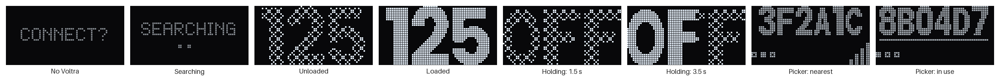
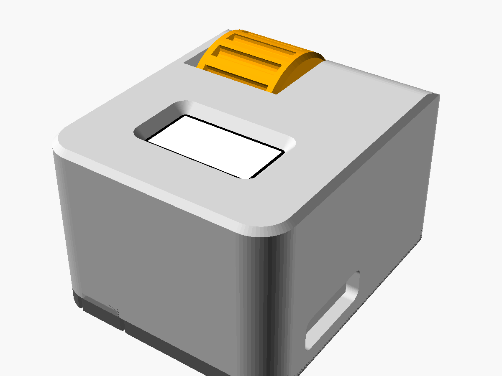
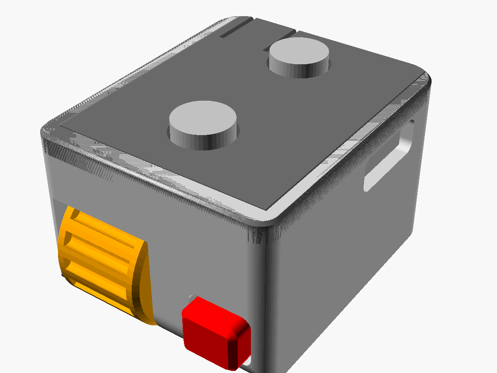
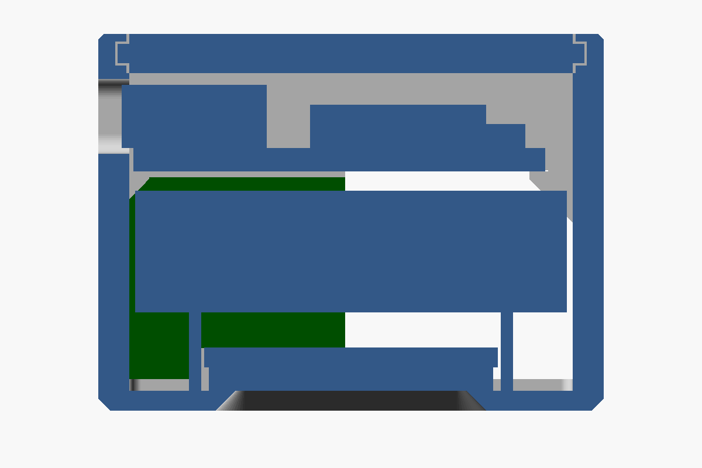

# Voltra Ring Nano

A smaller remake of [Voltra Ring](../voltra_ring): a Bluetooth remote for the **Beyond
Power Voltra I** that shows the weight and nothing else. It keeps the scroll wheel, the
load button, the magnetic mounts and USB-C charging, on a
[Seeed XIAO ESP32-C6](https://wiki.seeedstudio.com/xiao_esp32c6_getting_started/) with a
0.49" 64 × 32 OLED and a 601220 LiPo. The case is only as long as the display plus the
wheel and button; everything else is stacked behind the display.

| | Voltra Ring | Voltra Ring Nano |
|---|---|---|
| Case (wide × long × deep) | 29 × 63.8 × 21.9 mm | **25.8 × 31.5 × 19.2 mm** (about 60 % less volume) |
| Board | Waveshare ESP32-S3-Touch-LCD-1.47 | Seeed XIAO ESP32-C6 |
| Screen | 1.47" 172 × 320 colour touch LCD | 0.49" 64 × 32 OLED, weight only |
| Battery | 102535 (10 × 25 × 35 mm) | 601220 (6 × 12 × 20 mm, about 90–100 mAh) |
| USB-C | end face | side face, next to the display |
| Wheel | 14.1 mm, 19.7 mm wide | 14.1 mm, 10.3 mm wide |
| Button | 13 mm bar below the wheel | 6 mm bar beside the wheel |
| Mounts | clip, band plate | the same clip and band plate, unchanged |

The BLE client and protocol code is Voltra Ring's, unchanged; the drivers, the UI and the
case are new.

> **Unofficial.** This is an independent project, not affiliated with or endorsed by
> Beyond Power. It drives the Voltra through a reverse-engineered protocol, and a
> firmware update could change that protocol. Use it at your own risk, and keep clear of
> the cable when loading.

> **Not yet built.** The firmware compiles and the case renders, but neither has met
> real parts. Before printing, check the dimensions under
> [Check against your parts](#check-against-your-parts).



## The screen

| Shows | Means |
|---|---|
| `CONNECT?` | No Voltra. Press the button to pair with the nearest one, or double-click to choose. |
| `SEARCHING`, dots filling in below | Looking for or connecting to the Voltra |
| the weight, cross-hatched | Unloaded |
| the weight, solid | Loaded. During a set with chains, inverse chains, mountain or eccentric on, it follows the live resistance, as the Voltra's own screen does. |
| the weight, blinking | Auto load: slow while it waits for the cable pull, fast through the 3 s countdown |
| `OFF`, filling in | The button is being held to power off: it starts cross-hatched and fills in solid from the left, reaching the right edge at 5 s; let go to cancel |
| letters and dots | The Voltra picker (below) |

Accessories are set on the Voltra itself. Presets are gone along with the touch screen.

## What you need

- A Beyond Power **Voltra I**.
- A **Seeed XIAO ESP32-C6**.
- A **0.49" 64 × 32 I²C OLED module** (SSD1306 or SSD1315 controller, address 0x3C), for
  [HiLetgo's 4-pin module](https://www.amazon.com/dp/B0CDWXFCN2), which the case is drawn
  for: a 15 × 16 mm board with the panel on its front and four pin holes along one end.
  Solder wires to the pin holes (no header), and trim the switch's and encoder's leads
  flush on the back of the protoboard, as the OLED ends about 1.7 mm from it.
- A **601220 LiPo** (6 × 12 × 20 mm, about 90–100 mAh) **with a protection board**, the
  board on one end and the leads coming off it. The case allows 22 mm for the cell and its
  board together. The XIAO charges at about 100 mA, which is about 1 C for this cell: the
  most it should take, so pick a cell rated 100 mAh or more. The runtime is a guess until
  measured: about 3–4 hours of use per charge at the 20–30 mA the remote is likely to draw.
- A mouse-wheel style rotary encoder and a 6 × 6 × 5 mm tact switch (as Voltra Ring), and
  a strip of protoboard.
- Two 6 × 3 mm magnets for the lid (plus two per mount), a 1 mm foam pad, and thin wire.
- The [3D-printed case](#3d-printed-case), a USB-C data cable, and
  [PlatformIO](https://platformio.org/).

Nothing has to be removed from the XIAO: it has no power LED, only a charge LED.

## Wiring

All the controls switch to GND; the firmware turns on the ESP32's internal pull-ups.

| XIAO pin | GPIO | Goes to |
|---|---|---|
| D1 | 1 | push button, other leg to GND (an LP pad, so it can wake the chip) |
| D2 | 2 | encoder A |
| D3 | 21 | encoder B |
| D4 | 22 | OLED SDA |
| D5 | 23 | OLED SCL |
| 3V3 | | OLED VCC |
| GND | | OLED GND, encoder common, button |
| BAT+ / BAT− pads (underside) | | the battery |

Most OLED modules carry their own I²C pull-ups; add 4.7 kΩ to 3V3 on SDA and SCL if yours
does not.

The XIAO lies on its back on top of the battery, so its battery pads face the battery and
its castellated pads are on its long edges. Keep the wires and joints on the underside
within the 1 mm gap, and run the wires down past the battery's ends: at the near end wall,
and through the wire gap in front of the protoboard.

## 3D-printed case

Everything printable is in [`case/`](case): `voltra_ring_nano_case.scad` is the OpenSCAD
source (every dimension a named variable near the top, the assembly steps in its header),
`case/stl/` holds the exported parts and `case/renders/` some previews.

| Front | Back, lid on |
|---|---|
|  |  |

| Section along the case, through the switch | Section across the case, through the stack |
|---|---|
|  |  |

**Layout.** The case is as long as the display plus the controls bay; everything else is
stacked behind the display. From the display face back:

1. **OLED module**, face down behind the window, in a frame of ribs.
2. **Battery**, lying across the case on the frame's side ribs.
3. **XIAO**, lying across the case on its back, with its USB-C, shield and antenna toward
   the lid. Its USB-C comes out of the side wall, and it reaches over the wire gap and the
   top edge of the protoboard. With its antenna facing out through the lid rather than into
   the battery, the radio has only 2 mm of plastic in its way.

In the controls bay at the far end, the switch and the encoder sit side by side on a strip
of protoboard standing across the case, so the button is beside the wheel on the end face.

Turning the XIAO to stand on end, with its USB-C pointing out of the back, would make the
case about 27 mm deep and put the port under the mounts. Lying across the case it fits
behind the battery in 19 mm.

**Lid.** The lid slides in from the near end. Tongues along its long edges run in grooves
in the side walls, and a sprung finger at its near end, beside the magnets, clicks a ridge
into a notch on the end wall. There are no screws. To open it, lift the end of the finger
with a fingernail and slide the lid out.

**Mounts.** The lid carries the same two 6 × 3 mm magnets as Voltra Ring's, 16 mm apart on
the centreline and standing out by the same 1.4 mm. Voltra Ring's barbell clamp and band
plate fit unchanged. Their STLs are here too, so you don't need the other project. Glue
the lid's magnets with opposite poles out (one N, one S), as on Voltra Ring. The band
plate's tunnel takes a 20 mm strap (`band_20`); `band_13` is the same plate for a 1/2" (13 mm) one,
such as a 1/2" elastic hook-and-loop strap (`strap_w` / `strap_w_narrow` for other widths).

### Parts

| STL | Material | Print | Notes |
|---|---|---|---|
| `voltra_ring_nano_tub.stl` | PLA / PETG | display face down | the case body |
| `voltra_ring_nano_lid.stl` | PETG preferred | outer face down, no supports | sliding lid; the finger flexes, which PETG takes better than PLA |
| `voltra_ring_nano_wheel.stl`, `_shaft.stl` | PLA / PETG | as exported | scroll wheel and its shaft (shaft: use a brim) |
| `voltra_ring_nano_button.stl` | PLA / PETG | as exported (on its side) | button bar |
| `voltra_ring_nano_clip_a.stl`, `_clip_b.stl`, `_liner_a.stl`, `_liner_b.stl` | PLA / PETG, liners **TPU** | as exported | barbell clamp, as Voltra Ring's |
| `voltra_ring_nano_band_20.stl` | PLA / PETG | as exported | band plate for a 20 mm strap, as Voltra Ring's |
| `voltra_ring_nano_band_13.stl` | PLA / PETG | as exported | the same band plate for a 1/2" (13 mm) strap instead of a 20 mm one |
| `voltra_ring_nano_fit_test.stl`, `_fit_tips.stl` | PLA / PETG | as exported | optional test prints for the shaft's small hex fits |

`case/protoboard_template.svg` is the protoboard's outline with the encoder and switch
drawn on it, seen from the component side.

### Assembly

1. Solder wires to the OLED module and lay it face down in its frame behind the window,
   its pin end toward the controls. A tab on the USB-C side stops that end; on the other
   side the wheel passes about 1.1 mm from its corner, leaving room for the panel's ribbon
   where it bends round that end.
2. Put the button into its hole from inside.
3. Build the protoboard and slide it into its groove in the side wall from the open back,
   components facing the far end.
4. Push the wheel in through the corner opening from outside (diagonally), then push the
   shaft in through the side hole. Turn the shaft until its thin tip drops into the
   encoder, then turn the wheel until the shaft's thick hex drops into the wheel's snug
   hex, and push it home.
5. Lay the battery flat on the OLED frame's ribs, its leads toward the USB-C side, and
   stick the foam pad on its back.
6. Wire the XIAO to the OLED, the protoboard and the battery, then lay it on its back on
   its ledges, USB-C end first into the side cutout.
7. Slide the lid on from the near end until the finger clicks.

### Check against your parts

These are drawn from listings, not measured. Each is one variable at the top of the SCAD.
Render with `openscad -o x.echo --export-format echo case/voltra_ring_nano_case.scad` to
see the resulting size, and an assert names any clash.

- **XIAO:** `xiao_w` (listings say 17.5 or 17.8), `xiao_pcb_t`, `xiao_top_h` (the USB-C is
  the tallest part), and `usb_over`. It clears the wheel by only about 1 mm along the
  case, and an assert catches a longer board.
- **OLED module:** the board (`oled_pcb_w`, `oled_pcb_l`; HiLetgo lists 15 × 16 mm), the
  glass thickness, the parts on its back (`oled_back_h`, which the battery rests just
  above), and where the active area sits on it (`oled_aa_dx`, `oled_aa_dy`). The window is
  cut over the active area. HiLetgo does not say where that is; `oled_aa_dy` (0: the board's
  centre) was set by checking the window against prints.
- **Battery:** `bat_x` (the cell's length plus its protection board, across the case),
  `bat_y` and `bat_h`. A thicker cell makes the case deeper by the same amount. Only a cell
  about 12 mm wide fits behind the display; a larger one (602020, about 200 mAh) would have
  to go behind the XIAO, about 6 mm deeper again.

## Installing

1. Connect the XIAO over USB-C.
2. Build and flash:

   ```bash
   pio run -e remote -t upload
   ```

   The first build downloads the RISC-V toolchain, which takes a few minutes. If the
   XIAO doesn't show up, hold its BOOT button while plugging it in.

**Windows:** build from PowerShell or cmd, not Git Bash/MSYS, as for Voltra Ring.

Each build also writes `.pio/build/remote/firmware.factory.bin`, which can be written at
offset `0x0` with [ESP Web Flasher](https://espressif.github.io/esptool-js/).

### First-time setup checks

Each is one line in `platformio.ini`:

- **Picture upside down?** Flip `-DOLED_ROTATE_180`.
- **Picture shifted, cut off or garbled?** The panel sits differently in the controller's
  memory: try `-DOLED_COL_OFFSET=0` (or 28, 32), or `-DOLED_COM_PINS=0x02`.
- **Wheel goes the wrong way?** Flip `-DKNOB_INVERT`.
- **One detent moves two steps, or the two directions step differently?** The wheel is
  decoded for the case's mouse-wheel encoder, which rests with A and B high at every other
  detent (`src/hw/knob.cpp`). Another encoder may need its own decoding: log the A/B
  levels at each edge to see how yours behaves.
- **Unloaded and loaded too alike?** Widen the cross-hatch: `HATCH_PITCH` at the top of
  `src/ui/ui.cpp` is the spacing of its lines in pixels (5; 6 is sparser still).

## Using it

**Pairing.** Switch the Voltra on, stand next to it, and press the button. The remote
listens for 3 seconds and pairs with the strongest Voltra it hears (`VTR-…`). It remembers
it and reconnects by itself from then on. Pressing the button while it shows `CONNECT?`
or `SEARCHING` pairs again.

**Choosing a Voltra.** With more than one Voltra about, double-click the button (any time
it is not loaded) to open the picker. It shows the end of a Voltra's name with the `VTR-`
dropped, as in the last two screens above: under it, a dot for each Voltra heard (the
filled one is the one shown) and, on the right, its signal strength. It opens on the
nearest one other than the Voltra in use, which comes first in the list and is underlined.
Roll the wheel to go through them and press the button to connect to the one shown; the
remote remembers it from then on. Hold the button about a second, or leave the picker for
30 s, to back out with nothing changed. A Voltra in use stays connected while you look.

Telling clicks from double clicks costs a short wait: a press while unloaded takes effect
about 0.3 s after you let go. Unloading never waits, as the picker is not offered while
loaded.

| Do this | To |
|---|---|
| Roll the wheel | set the weight (slow: 1 lb, fast: 5 lb) |
| Press the button | load / unload (also with the cable already pulled out) |
| Double-click the button (not loaded) | open the Voltra picker: roll to choose, press to connect, hold to back out |
| Hold the button about a second, then let go | start auto load; press again to cancel it before it loads |
| Hold the button 5 s (`OFF` shows from 1.5 s) | power off; let go before 5 s to cancel |
| Hold the button 3 s while off | power on |

**Power.** Powered off, the ESP32-C6 is in deep sleep with only the button able to wake
it, and the OLED is in its sleep mode. What is left is the XIAO's regulator and charger
(about 15 µA together, per Seeed) and the OLED controller's standby current. There is no
battery reading: the case has no room for the divider it needs. For a true zero, put a
switch in the battery lead.

## Troubleshooting

- **It never pairs.** Make sure the Voltra is on, and close the Beyond+ app on your phone
  if it is connected: the Voltra may not advertise while another app holds the connection.
- **The screen stays dark.** Check SDA / SCL on D4 / D5 and that the module answers at
  0x3C (some are 0x3D: change `I2C_ADDR_OLED` in `include/board_pins.h`).
- **The wheel does nothing.** Check the encoder's common pin goes to GND and A / B to
  D2 / D3.

## Development

| Path | What |
|---|---|
| `src/voltra/` | The BLE client and protocol, as Voltra Ring's. See [docs/PROTOCOL.md](docs/PROTOCOL.md). |
| `src/ui/ui.cpp` | The whole UI: weight, pairing, the Voltra picker, load button, power off. |
| `src/ui/font_digits.h` | The 32 px digit font, generated by `tools/gen_digits.py` from Poppins Bold. |
| `src/ui/font_small.h` | The 16 px letters and digits for the picker, from the same script. |
| `src/ui/font_tiny.h` | A hand-drawn 5 × 7 pixel font for `SEARCHING` and `CONNECT?`. |
| `src/ui/knob_step.h` | Fine/coarse wheel stepping and snapping (unit-tested). |
| `src/hw/` | OLED (I²C, frame buffer), wheel (pin interrupts), button, deep-sleep power off / on. |
| `include/board_pins.h` | Pin map and OLED geometry. |
| `test/test_protocol/` | Unity tests for the protocol layer and the wheel stepping. |
| `case/` | The case: OpenSCAD source, STLs and renders. |

```bash
pio test -e native                   # 30 host-side tests
pio run -e remote_diag -t upload     # full serial logging, for protocol work
python tools/gen_digits.py --ttf tools/Poppins-Bold.ttf --out src/ui/font_digits.h --preview digits.png
python tools/gen_digits.py --ttf tools/Poppins-Bold.ttf --out src/ui/font_small.h --name small --height 16 --max-width 9 --chars "0123456789ABCDEFGHIJKLMNOPQRSTUVWXYZ-:"
```

## License

Released under the [Creative Commons Attribution-NonCommercial 4.0 International
License](LICENSE) ([CC BY-NC 4.0](https://creativecommons.org/licenses/by-nc/4.0/)): you
may share and adapt the firmware, case and documentation for non-commercial use, crediting
kirby6365 and this project and noting any changes. Commercial use needs separate
permission. The generated `src/ui/font_digits.h` and `src/ui/font_small.h` embed glyphs
from Poppins and remain under the SIL Open Font License (`tools/Poppins-OFL.txt`); the
third-party components under Credits keep their own licenses.

## Credits

The protocol work builds on community reverse-engineering by
[dylanmaniatakes/Beyond-Power-HomeAssistant](https://github.com/dylanmaniatakes/Beyond-Power-HomeAssistant),
[dylanmaniatakes/Beyond-Power-Voltra-Android](https://github.com/dylanmaniatakes/Beyond-Power-Voltra-Android)
and [jpamorgan/voltra-sdk](https://github.com/jpamorgan/voltra-sdk).

Third-party components:

- [NimBLE-Arduino](https://github.com/h2zero/NimBLE-Arduino): Apache License 2.0.
- [Poppins](https://github.com/itfoundry/Poppins): SIL Open Font License 1.1.
- [Arduino core for ESP32](https://github.com/espressif/arduino-esp32): LGPL 2.1; ESP-IDF: Apache License 2.0.

Beyond Power and Voltra are trademarks of their respective owner, used here only to
identify the device this remote works with.
